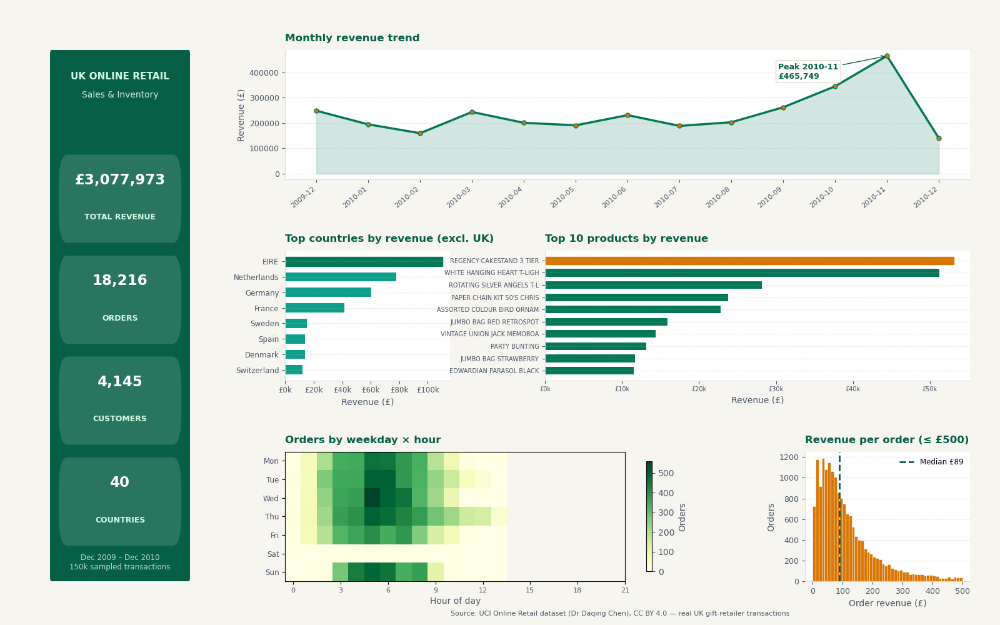

# UK Online Retail Sales & Inventory Analytics

A polished, multi-panel analytics dashboard built on **real retail data** from a
UK-based online gift retailer (Dec 2009 – Dec 2010).



## Dataset

- **Name:** Online Retail (II)
- **Source:** [UCI Machine Learning Repository](https://archive.ics.uci.edu/dataset/352/online+retail)
- **Donated by:** Dr Daqing Chen — **license CC BY 4.0 (attribution required)**
- The committed file is a cleaned, deterministically downsampled slice of the
  full dataset.

## Data shape

| Step | Rows | Columns |
|------|------|---------|
| Raw file | 525,461 | 8 |
| After cleaning | 511,565 | 9 (+`LineTotal`) |
| Committed sample (`data/online_retail.csv`) | **150,000** | 9 |

**Sampling note:** the raw file is ~43 MB, so it is downsampled with
`df.sample(n=150000, random_state=42)` — fully reproducible. The dashboard
computes everything from `data/online_retail.csv`. Run `download_data.py` to
re-fetch and reproduce the exact same sample.

Columns: `Invoice, StockCode, Description, Quantity, InvoiceDate, Price,
Customer ID, Country, LineTotal` (LineTotal = Quantity × Price, added during cleaning).

## Cleaning decisions

1. **Parsed `InvoiceDate`** as day/month/year (verified: 2009-12-01 → 2010-12-09).
2. **Dropped 2,928 rows** with missing `Description` (unidentifiable lines).
3. **Excluded 10,206 cancellation lines** — invoices starting with `C` carry
   negative quantities (returns). They were removed rather than netted, because
   the dashboard analyses *sales* revenue.
4. **Dropped 762 rows** with `Quantity <= 0` or `Price <= 0` (bad-debt
   adjustments, samples, zero-price lines) so they don't distort revenue.
5. For the Top-10-products panel, internal lines that are not real products are
   excluded: `Manual`, `DOTCOM POSTAGE`, `POSTAGE`, `AMAZON FEE`.

## Key insights (computed from the real data)

- **Total revenue:** £3,077,973 across **18,216 orders**, **4,145 customers**,
  **40 countries**.
- **Best month:** November 2010 — £465,749 (~15% of total revenue), the
  pre-Christmas spike. December 2010 drops off because the data ends on Dec 9.
- **Geography:** the UK dominates with 86.2% of revenue. Top international
  markets: Ireland (EIRE) £110,110, Netherlands £78,038, Germany £60,372.
- **Top product:** REGENCY CAKESTAND 3 TIER (£53,103), followed by
  WHITE HANGING HEART T-LIGHT HOLDER (£51,264) — giftware dominates sales.
- **Order behaviour:** median order £89, mean £169 (right-skewed — a few large
  orders pull the average up). 95% of orders are under £500.
- **Timing:** Thursday is the busiest weekday (3,702 orders), Saturday is
  almost dead (28 orders — B2B ordering pattern), and the daily peak is 12:00
  (2,914 orders).

## Tech stack

- Python, pandas, numpy, matplotlib (Agg backend)

## How to run

```bash
pip install -r requirements.txt
python download_data.py   # re-fetch + clean + sample the dataset (optional)
python dashboard.py       # regenerates dashboard.png
```

> **Power BI version:** to rebuild this dashboard in Power BI Desktop step by
> step (in Arabic), see [powerbi-guide.md](powerbi-guide.md) — the fastest path
> pastes [powerbi-page1-overview.py](powerbi-page1-overview.py) (KPIs + trends)
> and [powerbi-page2-details.py](powerbi-page2-details.py) (breakdowns) into two
> Python visuals. `dashboard.png` is the visual reference for the target layout.
